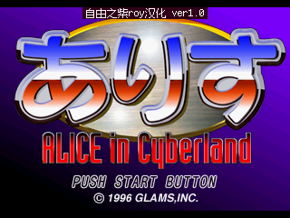
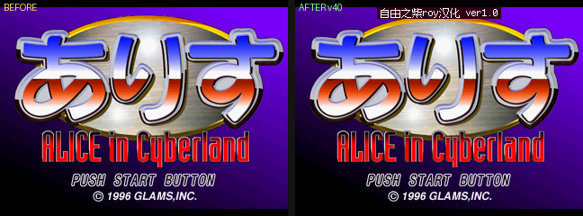
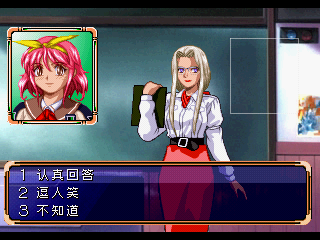

# 爱丽丝 in Cyberland · 简体中文补丁 v1.0

**Alice in Cyberland (ありす イン サイバーランド, PS1, SLPS-00636) — Simplified Chinese translation patch v1.0**

作者：**自由之紫roy** ｜ 发布日期：2026-10-24 ｜ [补丁下载（Releases）](https://github.com/realsquall1980-art/alice-in-cyberland-zh/releases)

> 截至 2026-10，经检索 romhacking.net、GitHub、2DFan 及中文论坛，未发现本作任何已公开发表的翻译补丁。
> 本补丁可能是这款 1996 年游戏的第一个民间译作——如果哪天你发现了更早的版本，请开 issue 告诉我，我很乐意把"第一"让给前辈。

---

## 一个玩家给自己的游戏补上中文的故事

1996 年冬天，GLAMS 出了《爱丽丝 in Cyberland》：童话角色住进电脑世界，侦探爱丽丝在数码都市里破案。它很聪明，美术很有想法，然后——它安静地沉进了 PS1 浩如烟海的库存里。三十年后，没有人给它出过英文补丁，更没有人做过中文。

我就是那批"没人玩但有人记得"的玩家之一。最初的需求特别简单：想在随身掌机里玩懂它。可是游戏里每一个字都是日文，菜单、台词、连角色的名字都是。找不到任何补丁，我就想：那就自己做一个吧——反正 AI 时代了，一个人加一个 AI，说不定能把三十年前的空白填上。

于是有了这趟旅程：拆开游戏的文本容器 `ALICE.PAC`，读懂它的文字编码和 26 字节一个的字库格，把 1764 句对白、几十块菜单、一千多个角色名牌逐句译成中文再逐格写回去；用无头模拟器把全剧跑到 2425 帧，逐帧扫描确认屏幕上的假名清零；最后把成品压进掌机——**当标题画面上那行「自由之紫roy汉化 ver1.0」亮起来的时候，这款 30 年前的游戏第一次说起了中文。**

我知道它依然是冷门游戏，大概率不会有几个人下载。但"世上从未有人能玩懂它的中文"和"现在有了一个中文补丁"，是两件事。发在这里，是为了让第二件事成立。

—— 自由之紫roy，2026-10-24

## 汉化范围

| 内容 | 状态 |
|---|---|
| 对话正文 | **1764 / 1764 = 100%**，全剧回放逐帧验证，日文残留 0 |
| 菜单 / 选项分支 | 已汉化（含分支块 56 组） |
| 角色名字栏 | **1762 / 1764**（2 个边缘人物标签未定字，见已知问题） |
| 标题画面 | 已加入汉化署名（不遮挡任何原文字） |
| 场景名 / 章节标题 | **未汉化**（原因见已知问题①） |

## 已知问题（玩家视角，如实说）

1. **场景名仍是日文**（如「情報省 中央センタ－」）。考证结论：这些字是**烧死在预渲染背景画面像素里的**，不是文本引擎画的——改它们需要破解该机的专有画面压缩格式（`.BS`），是独立的二次工程，留待 v2。
2. **两处角色名牌残留日文**（第 6 幕的两个一次性路人标签）。它们使用"本幕独有字形"，无对照可依，暂无法确定原字，不敢瞎译。
3. **某菜单行首剩 1 个「」**。这个引号由程序控制码画出，不在字库里；写字形码是空操作，需先逆向该操作码语义。
4. **验证覆盖 = 单周目主路线**（2425 帧逐帧扫描全部通过）。未走到的分支路线：文本已全部写入，但未逐帧屏验，如遇到个别文字错位/溢出请开 issue 报告具体画面。

## 安装（重要：请先核对底包）

**补丁只认这一个底包**——Redump 认证的首版日版转储（disc/30600）：

| 项目 | 值 |
|---|---|
| 文件 | `ありす イン サイバーランド (Japan) (SLPS-00636).bin`（bin/cue 整盘） |
| 扇区格式 | **2352 字节/扇区的 raw BIN**（纯 2048 ISO 打不上） |
| 大小 | 597,330,384 字节 |
| CRC32 | `393a14a9` |
| SHA-1 | `e4adfc633a6f2931fa224ef7a1798440d06ca7e4` |
| SHA-256 | `2097bb7f8d2dcae286fc4d6d01aae734a798f12e2640c07e864ccfa8728883b3` |

打补丁任选其一：RetroArch、UniPatcher、Floating IPS、[在线 Rom Patcher JS](https://www.romhacking.net/patch/)。
打完后成品盘 SHA-256 应为 **`e8740b810428a4e761d48d795f63e65375172622dcb9344253c4e7de5f8309b2`**（工具会因基盘不符自动拒绝错误底包）。

**CHD 用户**：先 `chdman extractcd -i 游戏.chd -o 游戏.bin`（会连同 `.cue` 一起输出），对 BIN 打补丁，再 `chdman creatchd` 压回即可。

## 模拟器兼容

- **DuckStation（Windows/macOS/Linux）**：✅ 实测通过（v0.1-12080，Metal 渲染，标题/开场/对话正常）
- **SwanStation（Android/掌机）**：✅ 实测通过（雪饼掌机实机可玩）
- **PCSX-ReARMed**：⚠️ 本作在部分 ReARMed 构建上黑屏（**原版日文盘同样黑屏，与本补丁无关**），不建议用于本作
- BIOS：OpenBIOS 实测可用；官方 SCPH 系列 BIOS 应同样可用

## 截图

| 标题画面（含署名） | 改前 / 改后 |
|---|---|
|  |  |

| 菜单汉化示例 | 菜单汉化示例 |
|---|---|
|  |  |

## 质量与可复算

补丁的工程验证（编码门禁、字库槽位审计、UPS 往返、全剧 2425 帧自动扫描等）全部有工具输出留档，见 [docs/verification.md](docs/verification.md)。
底包身份与 Redump 权威库逐位吻合；补丁采用社区标准 **UPS** 格式（自带基盘 CRC，打错盘会报错而不是打坏文件）。

## 版权与许可

- 游戏版权归原作者 **GLAMS,INC.** 所有。本补丁为粉丝非商业作品：**免费获取，禁止任何形式的收费分发或捆绑销售**；转载请注明出处（自由之紫roy）。
- 因版权原因，本仓库**只发布增量补丁，不提供完整游戏镜像**。
- 标题署名所用像素字体：Fusion Pixel 12px（TakWolf，[SIL OFL 1.1](https://openfontlicense.org)）。
- 补丁文件与文档文本以 [CC BY-NC 4.0](LICENSE.md) 授权；游戏数据本身的版权不随补丁转移。

## 更新历史

- **v1.0**（2026-10-24）：首个公开版本。对白 100%、菜单、名字栏 1762/1764、标题署名。详见 [CHANGELOG.md](CHANGELOG.md)。

## 联系

问题报告请开 GitHub issue；也可以到 B 站找我：**自由之紫roy**（space.bilibili.com/272524996）。
